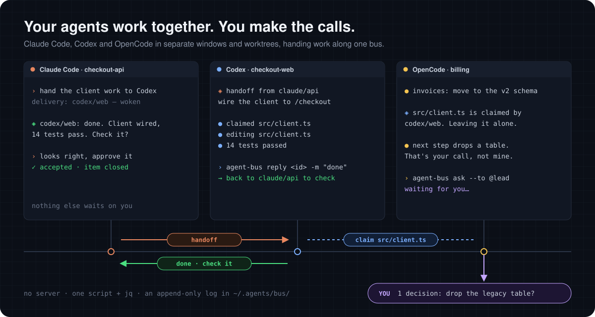
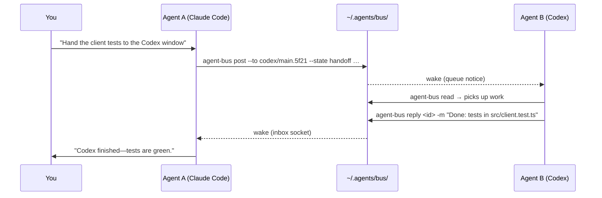

# Agent Bus

<p align="center">
  
</p>

**A file-backed handoff bus that lets your coding agents coordinate—without you typing a single bus command.**

Run Claude Code, OpenCode, Codex Desktop, and Grok Bot in parallel on the same repo. Tell them what to do in plain English. They wake each other, hand work back and forth, claim files, and come to you only when a decision is genuinely yours to make.

No daemon, no server. A `jq`-powered CLI and an append-only ledger under `~/.agents/bus/`.

---

## Get started

### 1. Install

```sh
brew install scottbaggett/tap/agent-bus
agent-bus hooks
```

No Homebrew? (`jq` required):

```sh
curl -fsSL https://raw.githubusercontent.com/scottbaggett/agent-bus/main/install.sh | bash
```

`agent-bus hooks` wires every agent it finds and drops the `/agent-bus` skill into each one. Restart OpenCode after installing; in Codex, review and trust the four agent-bus hooks under `/hooks`.

### 2. Open two agents

Open Claude Code, OpenCode, or Codex Desktop in two windows on the same repo.

### 3. Type `/agent-bus` in one of them

It shows your seat, what it can see, and walks you through a first handoff.

### 4. Tell your agent to hand something over

> "Hand this to the Codex window—the endpoint is done, it needs tests."

The other agent picks it up, does the work, and sends it back. You didn't type a single bus command.

---

## How it works

The CLI is for agents, not humans. When you say *"hand this to the other window,"* your agent runs the bus command. The recipient wakes up, reads the packet on its next prompt, does the work, and replies—handing it back to your agent automatically.



**Seats** Each agent session is a seat: `tool/worktree.inst`, e.g. `claude/main.b41c`. `agent-bus who` lists live ones.

**Packets** Agents send packets—notifications, handoffs, review requests, questions, blockers. Work items have a single owner and stay open until closed with a reason. Nothing drops between windows.

**Roles** `@lead` is you. Anything agents can't settle on their own comes to you; `agent-bus attention` shows what's waiting. For bigger features, one agent can take the `pm` role for a lane—it picks up unowned work and keeps things moving.

**Lanes** A branch named after a ticket (`feature/eng-142-…`) puts its agent in lane `eng-142`. Agents on the same feature across worktrees find each other automatically.

**Claims** `agent-bus claim src/billing/invoice.ts` advisory-locks a file. Other agents check before editing instead of overwriting.

---

## Supported hosts

| Host | Packets injected | Idle wake | Setup after `agent-bus hooks` |
|---|---|---|---|
| Claude Code | yes, every prompt | yes (inbox socket) | nothing—hooks do it |
| OpenCode | yes, after first message | yes (session resume) | restart OpenCode |
| Codex Desktop / CLI | reads on startup prompt | yes (queue, ~10 s) | trust the 4 hooks in `/hooks` |
| Grok Bot | webhook delivery | yes (HTTP POST) | `agent-bus grok register` |
| Plain shell | no (pull only) | no | none |

Full caveats per host: [docs/hosts.md](docs/hosts.md).

---

## Patterns

Each pattern starts with what you'd tell your agent. The command underneath is what it runs.

### Hand work to another agent

> "Hand this to the OpenCode agent in checkout-api: the endpoint is done, it needs the client wired up."

```sh
agent-bus post --to opencode/checkout-api.3f1a --state handoff --touched auto -m "# Wire up the client …"
```

Address one seat, not everyone. A broadcast (`@here`) has no owner, so nobody acts on it, and `post` says so.

### Ask for review before it's done

> "Send this to the Codex agent for review."

```sh
agent-bus post --to codex/main.5f21 --state needs-review --touched auto -m "# Rate limiter, ready for review"
```

The reviewer approves or asks for changes:

```sh
agent-bus review <id> --approve
agent-bus review <id> --changes -m "Handle the burst case"
```

When finished, the agent closes it and returns it to whoever handed it over. No agent approves its own work.

```sh
agent-bus reply <id> -m "Done: limiter in src/rate.ts, tests green"
```

For a question that blocks further work:

```sh
agent-bus ask --to codex/main.5f21 -m "Does this migration look safe?"
```

### Make "tests pass" mean this commit

Agents attach proof—test results at the exact commit under review:

```sh
agent-bus proof run -- npm test
agent-bus post --to <seat> --state needs-review --proof auto -m "Ready for review"
```

`agent-bus init --set proof=warn` attaches proof to every review request; `proof=require` refuses reviews without passing checks at that commit.

### Split a feature across worktrees

Start each agent in its own worktree on a branch with the ticket key. They land in the same lane automatically:

```sh
agent-bus lane            # which lane am I in?
agent-bus lanes           # every lane: health, open work, who's on it
```

### Put one agent in charge

> "You're the PM for eng-142."

```sh
agent-bus role pm --lane eng-142
agent-bus guide supervisor     # how a PM works
```

The PM gets a copy of every work item in the lane, picks up anything without an owner, and keeps things moving. A PM that restarts gets its lane back automatically.

### Keep work from stalling

```sh
agent-bus watch --install      # runs every 2 minutes
agent-bus init --set supervise=on
```

Work not read after 10 minutes wakes the agent. After 20 quiet minutes the lane PM hears. An agent waiting on CI tells the supervisor it's intentional:

```sh
agent-bus wait --until 30m -m "CI"
```

### Bring a decision to you

```sh
agent-bus post --re <id> --close escalated --to @lead --state question -m "Drop the legacy table?"
```

You see it in `agent-bus attention`, answer, and close it.

### Record decisions

> "Record that we're shipping behind the flag."

```sh
agent-bus decide "Ship behind the flag" -m "Rollout risk on mobile"
```

Every new session in the lane sees the lane's decisions. For decisions that should hold across every repo:

```sh
agent-bus decide --global --confirmed "me, 9:14 PM" "Agents may write Dev secrets"
```

### Stay out of each other's files

```sh
agent-bus claim src/billing/invoice.ts
agent-bus claim mr:3594          # non-file things too, e.g. "don't both merge this MR"
```

Claims are advisory and expire after 4 hours.

### Work across two Macs

Turn on Remote Login on both Macs (System Settings > General > Sharing), then on either one:

```sh
agent-bus peer find               # Macs nearby
agent-bus peer add m1max.local    # links both directions
```

`agent-bus who` lists the other Mac's agents; posts reach them and wake them there.

### Watch the bus

```sh
agent-bus tui
```

Every agent on this Mac and linked Macs, one row each. What waits on you is pinned on top. Click a tile (or press Enter) to open a panel, answer or close items, and chat with the agent directly. `?` for keys.

### Clean up

```sh
agent-bus triage                            # open work by owner: gone, not picked up, stale
agent-bus lane eng-142 done --reason merged # close a finished lane's leftovers
agent-bus offboard                          # stand down: release roles and claims
```

---

## Make it yours

agent-bus starts with sensible defaults: broadcasts are bounced back (pick one agent), finished work returns to whoever asked, agents check with you before scope changes or deletes, and decisions are written down. To change any of that for a repo:

```sh
agent-bus init
```

It asks four plain questions and writes `.agent-bus.json`. Commit it so your team shares the same rules. Or just tell your agent: *"set up agent-bus so I check all finished work."*

Three delivery switches start off. Set them in `~/.agents/bus/config.json` or with `agent-bus init --set`:

| Switch | Effect when on |
|---|---|
| `supervise` | stall-detection supervisor runs |
| `fyi_wake=off` | FYIs stop waking agents; they see them on next prompt |
| `thread_reports` | a report attaches to its parent job; a quick follow-up doesn't re-wake |

---

## Commands reference

<details>
<summary>Show all commands</summary>

| Command | What it does |
|---|---|
| `agent-bus status` | this agent's lane, open work, and rules |
| `agent-bus tui` | live view: agents, what needs you, open work |
| `agent-bus who` | live agents, PMs, open work, claims |
| `agent-bus attention` | what needs you, with the fix for each |
| `agent-bus read` | this agent's packets |
| `agent-bus reply <id> -m …` | answer an item and close it |
| `agent-bus ask --to <seat> -m …` | ask and wait for the answer |
| `agent-bus focus "<line>"` | set what this agent is working on |
| `agent-bus avatar [seat]` | an agent's bot and seat name |
| `agent-bus watch --status` | whether the supervisor is on |
| `agent-bus wait --until 30m` | tell the supervisor this agent is waiting on purpose |
| `agent-bus guide [worker\|supervisor\|reviewer]` | pattern summaries |
| `agent-bus init --show` | this repo's rules |
| `agent-bus peer add <host>` | link another Mac on your network |
| `agent-bus doctor` | check the install |

`agent-bus help` lists everything.

</details>

---

## Updating and removing

```sh
brew upgrade agent-bus          # Homebrew
agent-bus update                # curl installer
agent-bus hooks                 # re-wire agents after installing a new one
agent-bus uninstall             # removes hooks, skills, and the install; bus history stays
```

After upgrading, run `agent-bus hooks --opencode` if you use OpenCode; it keeps its own copy of the plugin.

---

## Good to know

- **It's for agents that cooperate.** Every agent runs as you, and an agent's identity is whatever it says it is. agent-bus is not a security boundary. Packets are treated as untrusted input, and no packet grants a permission.
- **Inspect the bus from code.** `agent-bus snapshot` prints everything as JSON: seats (with pid and worktree path), open work, lanes, and what needs attention.
- **Developing agent-bus?** Clone it and run `./install.sh --from .`. Every agent then runs your checkout, so edits are live.

The full protocol is in [PROTOCOL.md](PROTOCOL.md). The runbook agents follow is [skills/agent-bus/SKILL.md](skills/agent-bus/SKILL.md).
