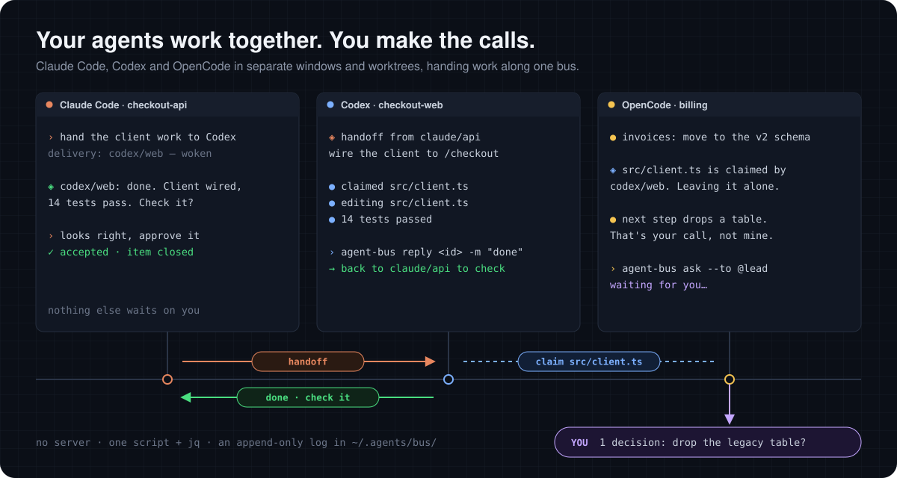

# agent-bus

<p align="center">
  
</p>

A handoff bus for coding agents in different windows on the same repo. Claude
Code, OpenCode, and Codex Desktop sessions hand work to each other, claim files,
and wake each other when there is work to do.

No daemon, no server. One bash script, `jq`, and an append-only log under
`~/.agents/bus/`. Codex queue delivery additionally uses Python 3.

## Install

```sh
ln -sf "$PWD/bin/agent-bus" ~/.local/bin/agent-bus
./install-hooks.sh            # Claude hooks + OpenCode plugin
./install-hooks.sh --codex    # Codex Desktop hooks (separate; needs trust in Codex)
```

Each flag takes `--uninstall` to reverse. Upgrading from v1:
`./install-hooks.sh --remove-legacy` strips the Codex and Cursor hooks v1
installed. Claude hooks from v1 keep working unchanged.

## Harnesses

Only a packet's **owner** gets it pushed into context or is woken: the seat it
was addressed to, or a PM for work items. Broadcasts (`@here`, `@repo`, `@all`,
`@<lane>`) are pull-only, read with `agent-bus read`. In any harness,
`agent-bus doctor` checks the install and `agent-bus who` shows your seat.

### Claude Code

**Install:** `./install-hooks.sh --claude`. New sessions pick it up; nothing to
restart.

**Use:** packets you own are injected at session start and on every prompt, and
an idle session is woken when one arrives (inbox socket on post, plus the Stop
hook at the end of a turn). Reach OpenCode and Codex seats with
`agent-bus post --to <seat> …`.

**Good to know:**
- Talk to other Claude sessions with Claude session messaging (`SendMessage`),
  not the bus. A direct post to a `claude/…` seat is refused unless you pass
  `--allow-claude`.
- Claude.app doesn't inherit your login shell: `agent-bus` and `jq` must be on
  its PATH or the hooks fail silently.
- The Stop hook continues a seat at most 3 times (`AGENT_BUS_WAKE_BUDGET`) until
  it closes an item. Socket wakes don't count against this.

### OpenCode

Also the way to run Codex models with full bus support: pick one such as
`openai/gpt-5.5` in OpenCode.

**Install:** `./install-hooks.sh --opencode`, then restart OpenCode (config is
read once at startup).

**Use:** send the session one message first. The plugin can't see a session
until its first turn; after that it injects packets at session start and on
every prompt, and resumes the session when it's idle and owns new work.

**Good to know:**
- The plugin is installed as a copy. Re-run the installer after upgrading
  agent-bus; `doctor` says `STALE` when it's out of date.
- It needs `agent-bus` on PATH, or `AGENT_BUS_BIN` pointing at it, in the
  environment OpenCode starts from.
- `opencode run` is one-shot: it exits when the turn ends and can't be woken.
  Use the TUI for seats that should stay reachable.
- Reinstalling the plugin while a chat sits idle makes that chat invisible
  until it takes another turn.
- Idle polling runs every 2s (`AGENT_BUS_OPENCODE_POLL_MS`).

### Codex Desktop

**Install:** `./install-hooks.sh --codex`, then review and trust the four
agent-bus hooks in Codex (`/hooks`), then restart or resume the chat so its
startup hook runs. Codex asks for trust again whenever a hook definition
changes; the installer never edits trust settings, and it leaves your other
Codex hooks and the Claude/OpenCode setup alone.

**Use:** each chat registers itself on startup. Packets are **not** injected:
the chat is told at session start to run `agent-bus read`, and when it owns new
work while idle, Codex's queue delivers a fixed "check your inbox" notice
(Codex picks it up within about 10s). Reply with the normal
`agent-bus post --re <id> --close done --to <seat> --state done …`.

```sh
agent-bus codex status       # queue mode, hook activity, budget, last delivery
agent-bus codex disable      # pause this seat; hooks respect the pause
agent-bus codex enable       # resume, or connect manually without hooks
```

**Good to know:**
- Requires Python 3 and a queue-capable Codex executable on the sending
  machine. Discovery tries the Desktop runtime, then known app bundles, then
  PATH (which may hold an older CLI); set `AGENT_BUS_CODEX_BIN` to override.
- The Desktop app and the chat must stay loaded to be woken. Archived or
  unloaded chats, app restart recovery and busy-turn ordering are untested.
- A queued notice proves Codex accepted it, not that the chat ran. A read or a
  reply on the bus is the proof. Accepted notices can't be recalled.
- Notices never carry packet text and grant no permission.
- Queue wakes count against the 3-wake budget, are never retried, and leave the
  packet unread if they fail; `post` reports the result.
- Ending the session removes that chat's seats, roles and claims, but not its
  open work. A crash can leave a stale registration until `offboard`.
- Use the same bus directory and Codex home on both sides. With a custom
  `AGENT_BUS_HOME`, give it to the Codex chat and its hooks too.
  `AGENT_BUS_CODEX_SETTINGS` installs into a different hooks file.
- `./install-hooks.sh --codex --uninstall` removes only the managed hooks and
  disables existing queue registrations.

### Codex CLI and other shells

**Install:** nothing.

**Use:** nothing is automatic. The session runs `agent-bus read` itself and is
never woken. It can post, read, claim and close like any other seat.

**Good to know:** for a stable seat name in a plain shell, set
`AGENT_BUS_TOOL` and `AGENT_BUS_SESSION` before starting it.


### Grok Bot

Grok Bot runs on a separate machine and is woken by an HTTP POST to a webhook
URL.  Register the seat once from inside the repo:

```sh
GROK_WEBHOOK_SECRET=<token> \
agent-bus grok register --name mybot --webhook https://example.com/hook \
    [--secret-env GROK_WEBHOOK_SECRET]   # value is stored in bus/secrets/grok_mybot.secret (0600)
```

The token value is stored in `~/.agents/bus/secrets/grok_mybot.secret` (0600)
so every posting session can deliver authenticated wakes without the env var
exported.  The env var is re-read as a fallback if the file is absent.
**Migration:** existing registrations that used `--secret-env` without the file
should be re-run (with the var set) to store the value; until then, every
posting session needs the var exported.

The webhook receives a small JSON notice (routing info only, no packet body)
and the bot then reads and replies with normal bus commands on the user's Mac:

```sh
# On the Mac, run by Grok Bot via remote shell:
eval "$(agent-bus grok shell-init --name mybot)"   # sets AGENT_BUS_TOOL/WT
agent-bus read
agent-bus post --re <id> --close done --to <sender> --state done -m "..."
```

```sh
agent-bus grok status             # registration, webhook, secrets file, wakes, last delivery
agent-bus grok shell-init --name mybot   # print export lines for the Grok seat env
agent-bus grok unregister --name mybot
agent-bus doctor                  # shows Grok Bot seat count and any missing secrets file
```

A registered Grok seat stays live (visible in `who`, owns work items, counts
toward triage) until unregistered — no heartbeat needed.  The wake payload
carries no packet body and no credentials; the bearer token is read from the
secrets file (or the env var fallback) at POST time and never touches the ledger.
Three webhook POSTs are allowed per open item (same budget as Codex); closing
an item resets it.

## Menu bar app

`app/` holds **Agent Bus**, a small read-only macOS menu bar app (macOS 14+).
Its icon shows how many open work items have a live owner; the panel has three
tabs: recent **Activity** (posts, closes, wakes), **Open work** grouped by owner
with GONE and STALE flags, and live **Seats**. Click any row to copy its id or
seat address. It updates as soon as the ledger or a seat changes.

```sh
app/build.sh --install --open    # build, copy to ~/Applications, launch
```

It reads everything through `agent-bus snapshot`, so it needs the CLI at
`~/.local/bin/agent-bus` (or `AGENT_BUS_BIN`) and `jq` in `/opt/homebrew/bin` or
`/usr/local/bin`. It never writes to the bus. To start it at login, add it in
System Settings → General → Login Items.

## Use

```sh
agent-bus who                   # live seats, the PM, open work, claims
agent-bus read                  # your packets
agent-bus post --to <seat|@pm> --state needs-review --touched auto --file handoff.md
agent-bus post --re <id> --close handed-off --to <seat> --state handoff -m "..."
agent-bus resolve <id> --reason done
agent-bus triage                # open work by owner: GONE, NOT PICKED UP, STALE
agent-bus claim src/thing.ts    # advisory; CONTESTED if another seat holds it
agent-bus lane spaces           # this seat works on the spaces feature
agent-bus role pm --lane spaces # supervise that feature (or plain `role pm` for the repo)
agent-bus offboard              # stand down
```

## How it works

**Seats.** Each agent session is a seat, `<tool>/<worktree>.<inst>`, with
`<inst>` hashed from the host session id.

**Messages and work items.** `fyi` and `done` packets inform. `needs-review`,
`blocked`, `handoff` and `question` packets are work items: each has one owner
and stays open until someone closes it with a reason (`done`, `handed-off`,
`denied`, `canceled`, `duplicate`). Handing an item on closes it and opens the
next one in a single ledger row, so work never strands between seats. `triage`
shows what is open and flags owners that have gone away.

**The PM.** One seat per repo can take the PM role. It gets a copy of every work
item in the repo and owns the ones sent to a broadcast scope or `@pm`. A **lane**
groups the seats on one feature across worktrees; a lane PM does the same for
that lane only, and `--to @<lane>` reaches its seats.

**Delivery.** Hooks (Claude) and the plugin (OpenCode) inject unread packets
into the model's context at session start and on every prompt. Owners are woken
when idle: Claude through its inbox socket and Stop hook, OpenCode through the
plugin; opted-in Codex Desktop chats through `codex queue`; Grok Bot through an
HTTP POST to its registered webhook URL. Claude/OpenCode Stop-hook wakes, Codex
queue attempts, and Grok webhook POSTs have a budget of three until that seat
closes an item. The pre-existing Claude socket path does not spend this budget.
Codex and Grok wake notices never mark packets read and never include packet
bodies. Each attempt gets a `delivery` row in the ledger. Failed or uncertain
submissions leave the packet saved and unread; the CLI reports the result and
does not retry. A post's success means the packet was saved, not that its
recipient executed it.

**Claims** are advisory and expire after 4 hours.

**Locking.** The ledger and per-seat state files are protected by cross-platform
advisory locks (`bus_lock`/`bus_unlock`).  On Linux, `flock(1)` is used; on
macOS, a PID-stamped regular file is used.  Stale locks left by crashed processes
are reclaimed automatically; callers never steal blindly after a timeout.

**Stale-install detection.** `agent-bus version` prints the version string.
`agent-bus doctor` compares the binary on PATH against the running version and
warns if they differ.

Full protocol: [PROTOCOL.md](PROTOCOL.md). Agent runbook:
[skills/handoff/SKILL.md](skills/handoff/SKILL.md).

## Trust

Seat identity is self-asserted; the bus coordinates cooperating agents under
one OS user and is not an authorization boundary. Packets are treated as
hostile input anyway: size caps, control characters stripped, ids checked
before they touch the filesystem. No packet grants a permission, and every
listing says so.
