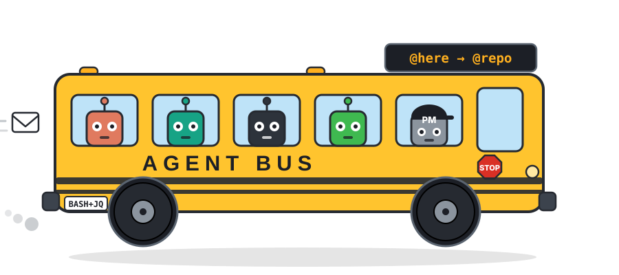

# agent-bus

<p align="center">
  
</p>

A handoff bus for coding agents in different windows on the same repo. Claude
Code and OpenCode sessions hand work to each other, claim files, and wake each
other when there is work to do. Run Codex models through OpenCode.

No daemon, no server. One bash script, `jq`, and an append-only log under
`~/.agents/bus/`.

## Install

```sh
ln -sf "$PWD/bin/agent-bus" ~/.local/bin/agent-bus
./install-hooks.sh            # Claude hooks + OpenCode plugin; --uninstall reverses
```

Upgrading from v1: `./install-hooks.sh --remove-legacy` strips the Codex and
Cursor hooks v1 installed. Claude hooks from v1 keep working unchanged.

## Use

```sh
agent-bus who                   # live seats, the PM, open work, claims
agent-bus read                  # your packets
agent-bus post --to <seat|@pm> --state needs-review --touched auto --file handoff.md
agent-bus post --re <id> --close handed-off --to <seat> --state handoff -m "..."
agent-bus resolve <id> --reason done
agent-bus triage                # open work by owner: GONE, NOT PICKED UP, STALE
agent-bus claim src/thing.ts    # advisory; CONTESTED if another seat holds it
agent-bus role pm               # supervise this repo
agent-bus offboard              # stand down
```

## How it works

**Seats.** Each agent session is a seat, `<tool>/<worktree>.<inst>`, with
`<inst>` hashed from the host session id.

**Messages and work items.** `fyi` and `done` packets inform. `needs-review`,
`blocked`, `handoff` and `question` packets are work items: each has one owner
and stays open until someone closes it with a reason (`done`, `handed-off`,
`denied`, `canceled`, `duplicate`). Handing an item on closes it and opens the
next one in a single ledger row, so work never strands between seats. `triage`
shows what is open and flags owners that have gone away.

**The PM.** One seat per repo can take the PM role. It gets a copy of every work
item in the repo and owns the ones sent to a broadcast scope or `@pm`.

**Delivery.** Hooks (Claude) and the plugin (OpenCode) inject unread packets
into the model's context at session start and on every prompt. Owners are woken
when idle: Claude through its inbox socket and Stop hook, OpenCode through the
plugin. A seat gets three wakes before it has to close something, which stops
two agents waking each other forever.

**Claims** are advisory and expire after 4 hours.

Full protocol: [PROTOCOL.md](PROTOCOL.md). Agent runbook:
[skills/handoff/SKILL.md](skills/handoff/SKILL.md).

## Trust

Seat identity is self-asserted; the bus coordinates cooperating agents under
one OS user and is not an authorization boundary. Packets are treated as
hostile input anyway: size caps, control characters stripped, ids checked
before they touch the filesystem. No packet grants a permission, and every
listing says so.
